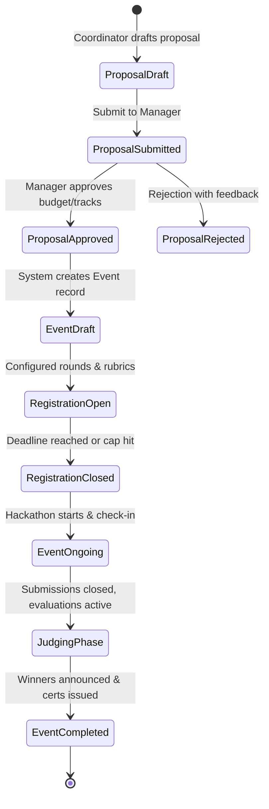

# [4] Technical Documentation
**Project**: Eventura (powered by Clientura) — Enterprise Event & Hackathon Platform  
**Document Version**: 1.0.0  
**Date**: October 29, 2026  
**Audience**: Enterprise Architects, Lead Developers, Security Reviewers, DevOps Engineers  

---

## 1. System Overview & Architectural Topology

Eventura is architected around a decoupled, high-performance web topology. The system combines an SSR-capable modern React client built on TanStack Start / Nitro with a high-throughput Express REST API server and a PostgreSQL 15+ relational database governed by Prisma ORM.

```text
┌─────────────────────────────────────────────────────────────────────────────┐
│                             CLIENT LAYER (PWA & SSR)                        │
│                                                                             │
│  React 19 + TypeScript + TanStack Router (File-based) + TanStack Query v5  │
│  Tailwind CSS + shadcn/ui primitives + Lucide Icons                         │
│  Nitro SSR Server (Serving compiled SSR HTML chunks on Port 8080)            │
└──────────────────────────────────────┬──────────────────────────────────────┘
                                       │ HTTPS / JSON REST API
                                       ▼
┌─────────────────────────────────────────────────────────────────────────────┐
│                          GATEWAY & SECURITY PERIMETER                       │
│                                                                             │
│  1. Express Global Middlewares (CORS, Rate Limiting, Helmet headers)       │
│  2. Authentication Guard (JWT Signature Verification, Token Expiry)         │
│  3. Tenant Guard (Strict x-organization-id enforcement & Member check)      │
│  4. RBAC Engine (Role & Granular Permission Resolver)                       │
└──────────────────────────────────────┬──────────────────────────────────────┘
                                       │ Authorized Request Context
                                       ▼
┌─────────────────────────────────────────────────────────────────────────────┐
│                              DOMAIN SERVICES LAYER                          │
│                                                                             │
│  • AuthService (Bcrypt, JWT, TOTP MFA RFC 6238)                             │
│  • OrganizationService (Multi-tenant workspaces, domain scoping)            │
│  • EventService & HackathonProposalService (Approval workflows, stages)     │
│  • RegistrationService & PaymentService (Stripe Checkout & Webhooks)        │
│  • ProblemStatementService (Eligibility verification & single-lock rules)    │
│  • SubmissionService (Artifact ingest & protected inline view streaming)    │
│  • EvaluationService (Rubric score calculations & real-time leaderboard)    │
│  • AttendanceService (Signed QR generation, gate scanning, session metrics) │
│  • CertificateService (Cryptographic PDF generation & SHA verification)     │
│  • GeminiAIService (Proposal classification, AI copilot, mentor assistant)  │
└──────────────────────────────────────┬──────────────────────────────────────┘
                                       │ ACID Transactions (prisma.$transaction)
                                       ▼
┌─────────────────────────────────────────────────────────────────────────────┐
│                            DATA PERSISTENCE LAYER                           │
│                                                                             │
│  PostgreSQL 15+ Relational Database (45+ Tables, Composite Indexes)          │
│  Local Disk / S3 Object Storage (Uploaded submission artifacts & PDFs)       │
│  In-Memory / Redis (Distributed rate-limiting and session cache)            │
└─────────────────────────────────────────────────────────────────────────────┘
```

---

## 2. Multi-Tenant Isolation Architecture

Eventura is designed for strict multi-tenancy where multiple universities, enterprise divisions, or corporate incubators share the same platform infrastructure without any possibility of cross-tenant data contamination.

### 2.1 The Zero-Fallback Tenant Model
In multi-tenant software, a common vulnerability is "silent fallback" (where a request without a tenant identifier defaults to a global or first-available tenant). In Eventura:
1. Every tenant-scoped request must supply the HTTP header:
   ```http
   x-organization-id: <organization-uuid>
   ```
2. The `tenant.middleware.ts` intercepts the request:
   - Verifies the user is authenticated.
   - Queries `OrganizationMember` where `userId = req.user.id` and `organizationId = headerOrgId`.
   - If the header is missing, the request is immediately rejected with `HTTP 400 MISSING_TENANT`.
   - If the user is not an active member of that organization, the request is immediately rejected with `HTTP 403 FORBIDDEN`.
   - Zero fallback queries are permitted.

### 2.2 Data Layer Multi-Tenant Scoping
All database queries in repositories and services enforce composite filtering:
```typescript
const events = await prisma.event.findMany({
  where: {
    organizationId: req.tenant.id,
    deletedAt: null,
  },
});
```

---

## 3. Authentication & Security Subsystems

### 3.1 Dual-Token Authentication Lifecycle
- **Access Tokens**: Short-lived JSON Web Tokens (15-minute expiration) signed with `JWT_SECRET` (HMAC SHA-256). Payload includes `userId`, `email`, and token issuance timestamps.
- **Refresh Tokens**: Longer-lived tokens (7-day expiration) signed with `JWT_REFRESH_SECRET` and stored with user session records. Rotating refresh tokens prevent replay attacks.
- **Password Protection**: Hashed using `bcrypt` with work factor 10. Plaintext passwords never enter logs or database tables.

### 3.2 Universal TOTP Multi-Factor Authentication
- Implements RFC 6238 Time-Based One-Time Passwords via `otplib`.
- Upon MFA enrollment, the server generates a base32 secret and an `otpauth://` QR code URI.
- Emergency recovery codes are cryptographically generated, hashed, and stored in `UserRecoveryCode`.
- During login, if `user.isMfaEnabled` is true, the server returns `mfaRequired: true` with a temporary MFA challenge token. The user must submit a valid 6-digit TOTP code before the full session JWT is issued.

### 3.3 Granular Role-Based Access Control (RBAC)
Eventura decouples roles from users via organization memberships:
```text
User ──── (1:N) ──── OrganizationMember ──── (N:1) ──── Role ──── (N:N) ──── Permission
```
- A user can be a `Student Coordinator` in Organization A, and a `Judge` in Organization B.
- Middleware helper `requirePermission("permission.name")` validates that the user's active role possesses the required permission.

---

## 4. Core Subsystem Workflows & Logic

### 4.1 Hackathon Proposal & Event Lifecycle


### 4.2 Problem Statement Permanent Lock Rules
- Participants browse available problem statements published for an event.
- Eligibility check verifies that the participant is registered with status in `['APPROVED', 'PAID', 'CONFIRMED', 'REGISTERED']`.
- When a team lead locks a problem statement, the system creates a permanent binding on `Team.problemStatementId`. Once locked, teams cannot arbitrarily swap problem statements, guaranteeing academic and corporate competition integrity.

### 4.3 Secure Submission File Streaming (`Content-Disposition: inline`)
- Submissions support multi-file uploads (slide decks, architecture diagrams, demo videos, zip archives).
- Files are saved in a protected upload volume.
- To prevent unauthorized file downloads or path traversal attacks, files are accessed strictly via:
  ```http
  GET /api/v1/submissions/:id/files/:fileId/view
  ```
- The controller verifies:
  1. Requester is the submitter or a member of the submitting team; OR
  2. Requester is an evaluator assigned to the submission's competition round; OR
  3. Requester possesses `submissions.manage` permission.
- The file is streamed with `Content-Disposition: inline` and sanitized MIME types, enabling seamless browser preview for judges without forcing downloads.

### 4.4 Automated QR Code Attendance
- Every approved registration receives a cryptographically signed QR code containing `registrationId` and a HMAC signature.
- Check-in coordinators use the embedded camera scanner (`html5-qrcode`) at event entrances.
- Scanning verifies the HMAC signature, confirms the attendee is registered for the active event session, logs check-in timestamp and volunteer ID, and prevents duplicate check-ins.

### 4.5 Digital Certificates & Public Verification
- Certificates are generated as vector PDFs via `pdfkit` featuring participant name, event title, award classification (Winner, Runner-up, Finalist, Participant), and an embedded QR code.
- Each certificate is assigned a unique SHA-256 verification string.
- Anyone can verify credential authenticity via the public URL:
  `https://<DOMAIN>/certificates/verify/:verificationCode`

---

## 5. Third-Party Integrations & External Gateways

### 5.1 Stripe Payment Engine
- Integrated via `@stripe/stripe-node` SDK.
- Free events bypass payment gateways and immediately transition registrations to `APPROVED`.
- Paid events create Stripe Checkout Sessions with line items matching the ticket tier.
- Stripe Webhook listener (`POST /api/v1/payments/webhook`) validates signatures (`STRIPE_WEBHOOK_SECRET`) and updates database registration records to `PAID` upon receiving `checkout.session.completed`.

### 5.2 Google Gemini Generative AI
- Integrated via `@google/genai`.
- **Hackathon Proposal Classification**: Evaluates proposed hackathon tracks, budgets, and hardware requirements, returning structured risk assessments for event managers.
- **AI Copilot & Mentor Assistant**: Provides participants with real-time technical guidance and debugging suggestions within competition guidelines.

---

## 6. High Availability & Deployment Topology

```text
                        ┌───────────────────────────────┐
                        │      Cloudflare / AWS WAF     │
                        │    (DDoS, SSL Termination)    │
                        └───────────────┬───────────────┘
                                        │
                                        ▼
                        ┌───────────────────────────────┐
                        │      NGINX Reverse Proxy      │
                        │    (HTTP/2, Static Caching)   │
                        └───────┬───────────────┬───────┘
                                │               │
          Path: /* (Web App SSR)│               │ Path: /api/* (REST API)
                                ▼               ▼
                ┌───────────────────────┐ ┌───────────────────────┐
                │ Nitro Node SSR Server │ │ Express REST API Pods │
                │      (Port 8080)      │ │      (Port 3000)      │
                └───────────────────────┘ └───────────┬───────────┘
                                                      │
                                                      ▼
                                        ┌───────────────────────────┐
                                        │ PostgreSQL Primary Cluster│
                                        │  (Prisma ORM + Replicas)  │
                                        └───────────────────────────┘
```
